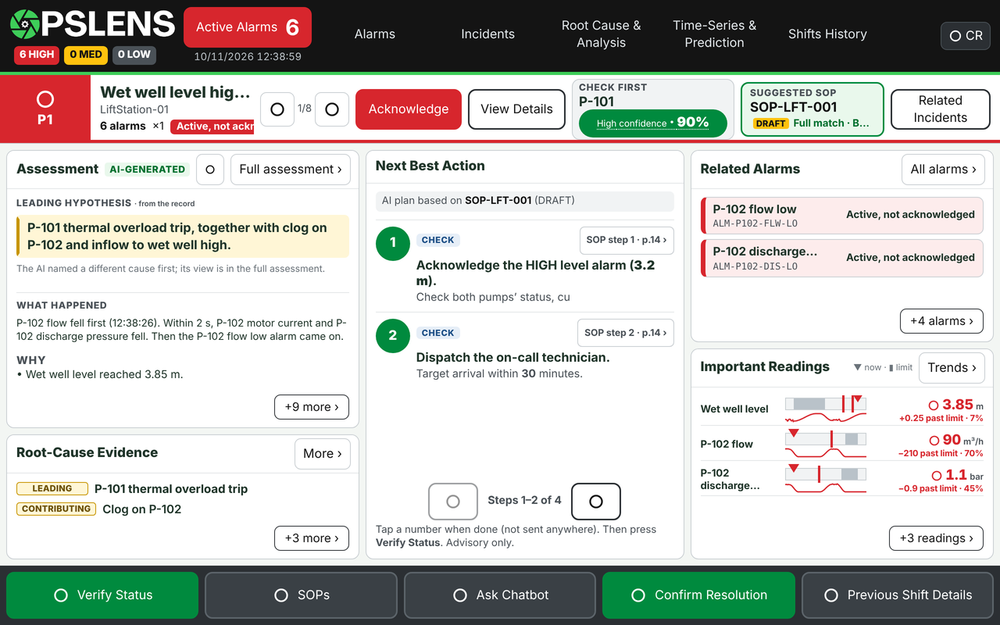
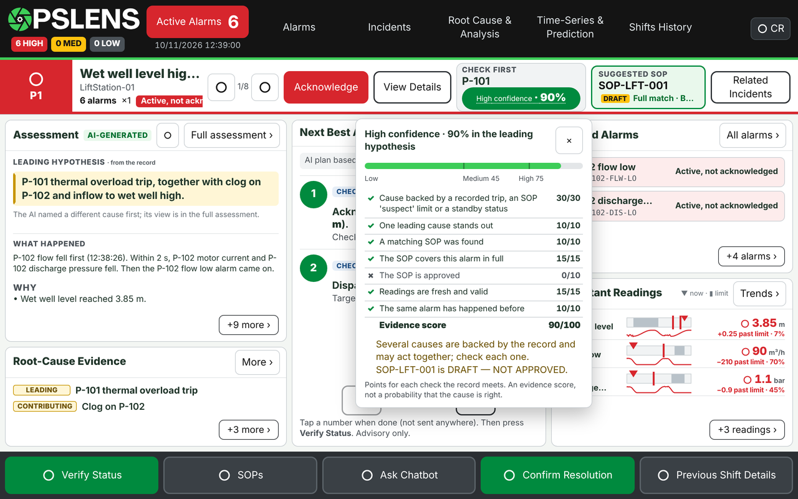
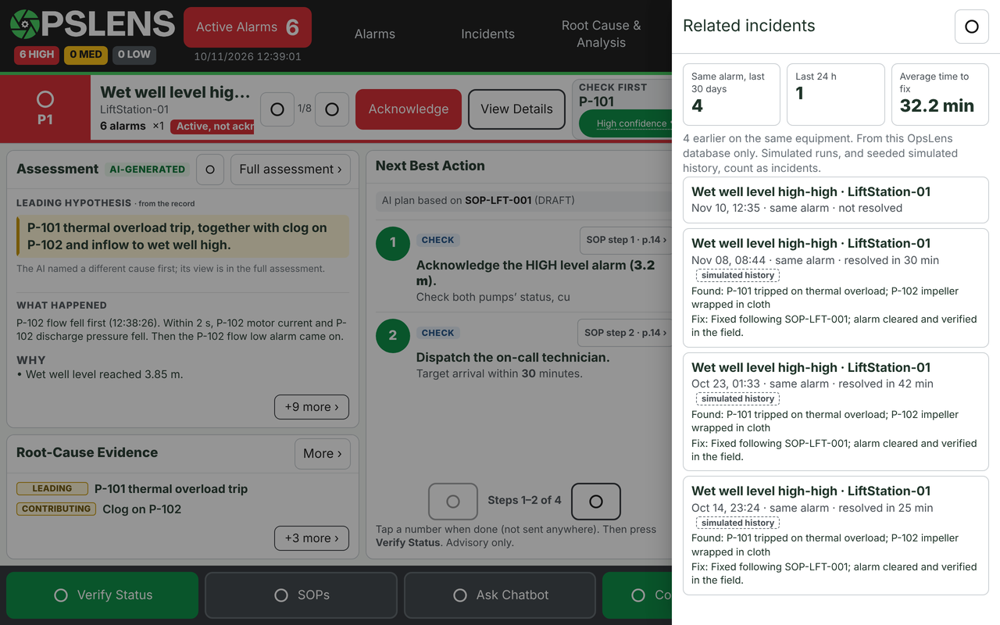
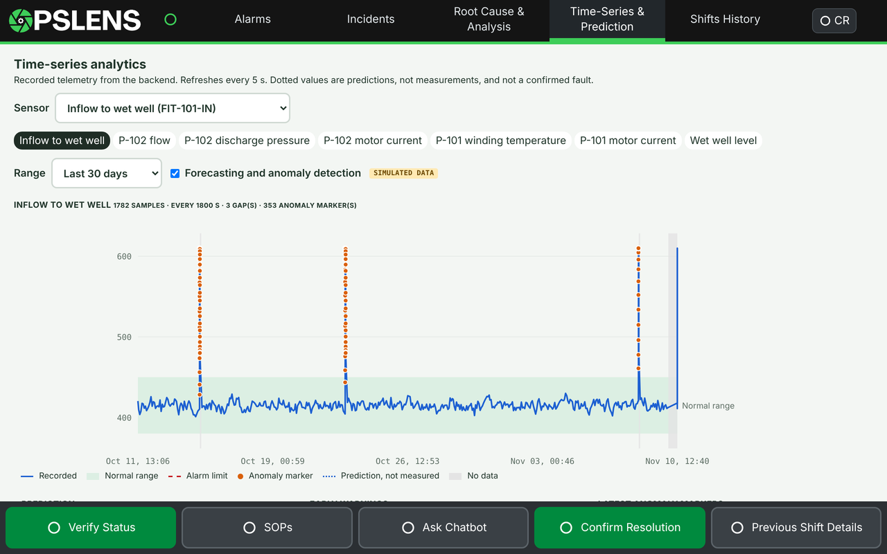
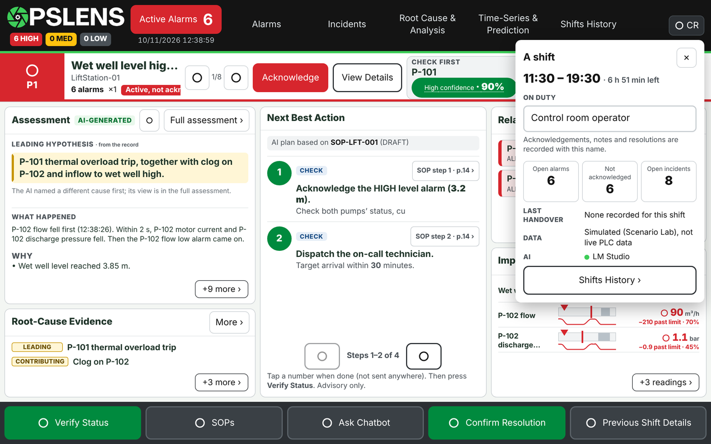
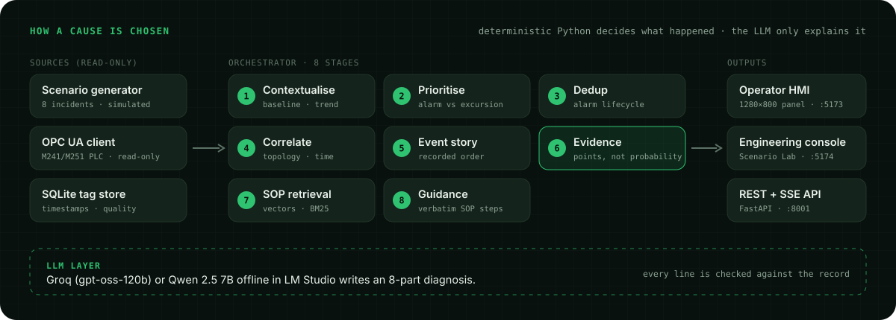

  

  <b>Winner</b>, Schneider Electric HMI Hackathon (Innovation Marathon) · SRM Institute of Science and Technology · 10 September 2026 
  Problem statement PS1: <i>AI-Powered Runtime Copilot for Industrial HMI</i> · Team Sentient Screens

  <code>FastAPI</code> · <code>React + Vite</code> · <code>SQLite</code> · <code>OPC UA</code> · <code>Qdrant / BM25</code> · <code>LM Studio (Qwen 2.5)</code> · <code>Groq</code> · <code>348 tests</code>

> [!NOTE]
> This repository is a **showcase**. The source code is kept private. If you'd like a walkthrough or access for a review, reach out on [LinkedIn](https://www.linkedin.com/in/dakshmehrotra).

---

## The problem

An HMI tells a plant operator *that* an alarm is active. It doesn't tell them what happened first, which equipment is really at fault, what the plant's procedure says, or how they'll know the fix worked. At 3 a.m., with six alarms flashing, that gap is where mistakes happen.

## What OpsLens does

OpsLens reconstructs **the story behind the alarm**:

- **Event story.** Which readings moved first, in recorded order, and which equipment they belong to.
- **Ranked root cause.** Cause candidates are built from the data and scored on their own evidence. Every point is explained, and scores are never presented as probabilities.
- **The right procedure.** The matching SOP section, with steps copied verbatim from the cited page and the exact limits that were crossed.
- **A plain-language diagnosis.** A cloud model (Groq) or a local one (Qwen 2.5 in LM Studio, fully offline) writes an 8-part briefing, and every line is checked against the incident record.
- **Read-only by design.** It never writes to a PLC, moves a valve or clears an alarm. The operator stays in control.

  
   Home during an active lift-station alarm: leading hypothesis, SOP-linked next steps, and how far each reading is past its limit.

<table>
  <tr>
    <td width="50%"> <b>Evidence Support</b>: a rule-based score with every check listed. Not a probability.</td>
    <td width="50%"> <b>Related incidents</b>: earlier fixes for the same equipment.</td>
  </tr>
  <tr>
    <td width="50%"> <b>Trends</b>: 30 days of data against the normal band and SOP limits.</td>
    <td width="50%"> <b>Shift handover</b>: what happened this shift, ready for the next operator.</td>
  </tr>
</table>

All screens use simulated plant data from the built-in Scenario Lab, captured on the target 1280 × 800 operator panel.

## How it works

  

Everything that decides *what happened* is deterministic Python. The language model only explains facts that are already established, so the diagnosis still works, clearly labelled, when no model is available.

### How a cause is scored

| Evidence | Points |
|---|---|
| Recorded trip or fault status | 25 (standby didn't start: 15) |
| Changed before the primary alarm | 20 (timing unknown: 5) |
| Size of the deviation | 15 past an SOP limit, up to 10 outside the normal band |
| Other readings agree | 5 each, up to 15 |
| SOP limit with an action exceeded | 10 |
| On the configured path to the alarm | 10 |
| Readings that contradict it | −5 each, down to −15 |

A candidate first seen *after* the primary alarm can't lead when an earlier one exists. Each candidate gets a role (Leading, Contributing, Related condition, Possible consequence or Insufficient evidence) and a note explaining its rank.

## Eight incidents, one without a procedure

The Scenario Lab replays eight wastewater-plant incidents with real limits from the plant's SOP manual: a jammed bar screen, clogged lift-station pumps, Nocardia foam, a failed RAS pump, a CHP engine trip, toxic centrate, an aeration-blower failure, and low UV intensity. The last one has **no SOP at all**, to show how OpsLens answers honestly when the manual is silent.

## Validation

- **348 automated tests** across the backend.
- **Tests A–D** check the ranking against known ground truth: a genuine fault, a misleading sensor, two competing faults, and evidence that changes mid-incident.
- Every AI answer shows where it came from: *AI-generated*, *Deterministic fallback*, *SOP retrieval only* or *AI unavailable*.

## Tech stack

| Layer | Tools |
|---|---|
| Backend | Python, FastAPI, asyncio, SQLite, Server-Sent Events |
| Industrial I/O | Read-only OPC UA client (Schneider M241/M251 PLCs) |
| Retrieval | Qdrant + sentence-transformers, BM25 fallback |
| AI | Groq `gpt-oss-120b` (cloud) or Qwen 2.5 7B Instruct in LM Studio (offline) |
| Frontend | React 18, Vite, Tailwind CSS: operator HMI and engineering console |

---

OpsLens is a student prototype built for the hackathon. It is not a Schneider Electric product and is not deployed at any plant. All plant data shown is simulated.
